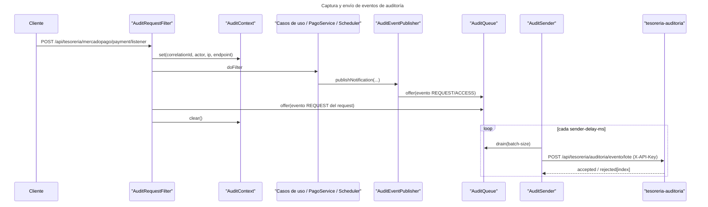

# Auditoría de MercadoPago Service

> Fecha: 2026-10-28
> Estado: implementado en el paquete `um.tesoreria.mercadopago.audit` (cambios aún no commiteados).
> Motivo: dejar trazabilidad de requests, cambios de preferencias y ejecuciones de jobs hacia
> `tesoreria-auditoria`.

Este servicio no tiene base de datos propia, así que no puede implementar un outbox transaccional.
La auditoría se resuelve con una **cola acotada en memoria** y un **envío por lotes** por HTTP.
La consecuencia es explícita: si el proceso muere o la cola se llena, los eventos en vuelo se
pierden (`AuditProperties`, `AuditQueue`).

## Componentes

| Clase | Responsabilidad |
|---|---|
| `AuditRequestFilter` | Arma el contexto del request (`correlationId`, actor, IP, método, endpoint) y emite el evento `REQUEST` al terminar, incluso si falló. Se registra como bean en `AuditConfiguration` (no como `@Component`) para que los `@WebMvcTest` no lo instancien. |
| `AuditContext` | `ThreadLocal` con los datos del request: `X-Request-Id` (si falta, UUID), `X-User-Id`/`X-Usuario-Id`, `X-Usuario-Login`, `X-Forwarded-For` (primer valor) o `remoteAddr`. |
| `AuditEventPublisher` | Punto único de emisión: preferencias, notificaciones de pago y jobs. |
| `AuditEventPayload` | Payload con los nombres del contrato de `tesoreria-auditoria`. |
| `PreferenceSnapshot` | Snapshot de campos de negocio de la preferencia y cálculo del diff. |
| `AuditQueue` | `ArrayBlockingQueue` de capacidad `queue-capacity`; al llenarse descarta y cuenta `dropped`. |
| `AuditSender` | Drena lotes y los envía con `RestClient`; reintenta hasta `max-attempts`. |

## Familias de eventos

| Nivel | Entidad | Operación | Origen |
|---|---|---|---|
| `CHANGE` | `MercadoPagoPreference` | `INSERT` | `CrearPreferenciaCuotaUseCaseImpl`, `CrearPreferenciaVacanteUseCaseImpl` |
| `CHANGE` | `MercadoPagoPreference` | `UPDATE` | `ActualizarPreferenciaCuotaUseCaseImpl` (sólo si el diff no está vacío) |
| `CHANGE` | `MercadoPagoPreference` | `INSERT`/`UPDATE` con `outcome=ERROR` | Fallo de Mercado Pago o preferencia inexistente |
| `REQUEST` | `MercadoPagoNotification` | `ACCESS` | `PagoService`: webhook v1, IPN legacy y replay manual |
| `REQUEST` | — | `ACCESS` | `CheckingScheduled` y `RenovacionScheduled` |

- `PagoService` audita **todas** las notificaciones, incluidas las rechazadas por firma o por
  `data.id` faltante, con `origin` (`WEBHOOK_V1`, `IPN_LEGACY`, `MANUAL`), `state`, `paymentId` y
  la presencia de `x-signature`/`x-request-id`.
- Un webhook genera dos eventos: el `REQUEST` del filtro y el `REQUEST` de la notificación de
  negocio, correlacionados por `correlationId`.
- Los jobs se emiten como `REQUEST` (no `CHANGE`) porque no hay entidad de negocio ni diff: importa
  que el proceso corrió, cuánto tardó (`durationMs`) y cómo terminó (`OK`/`ERROR`). En
  `checking-all-active` la excepción se audita y se vuelve a lanzar; en `renovacion-vencimientos`
  se audita y se absorbe.

## Flujo

Diagrama versionado para la documentación generada:
[`diagrams/flujo-auditoria.mmd`](diagrams/flujo-auditoria.mmd).

## Configuración

| Propiedad | Env | Default | Descripción |
|---|---|---|---|
| `tesoreria.audit.mode` | `TESORERIA_AUDIT_MODE` | `SEND` | `OFF` no captura; `LOG` captura y loguea; `SEND` encola y envía |
| `tesoreria.audit.request-events` | `TESORERIA_AUDIT_REQUEST_EVENTS` | `true` | Eventos `REQUEST` (requests y jobs) |
| `tesoreria.audit.change-events` | `TESORERIA_AUDIT_CHANGE_EVENTS` | `true` | Eventos `CHANGE` de preferencias |
| `tesoreria.audit.access-events` | `TESORERIA_AUDIT_ACCESS_EVENTS` | `false` | Auditar también `GET` |
| `tesoreria.audit.url` | `TESORERIA_AUDIT_URL` | `http://localhost:8211` | Base del servicio de auditoría |
| `tesoreria.audit.api-key` | `TESORERIA_AUDIT_API_KEY` | vacío | Header `X-API-Key`; vacío = no envía |
| `tesoreria.audit.queue-capacity` | `TESORERIA_AUDIT_QUEUE_CAPACITY` | `5000` | Tope de la cola en memoria |
| `tesoreria.audit.batch-size` | `TESORERIA_AUDIT_BATCH_SIZE` | `200` | Eventos por lote |
| `tesoreria.audit.max-attempts` | `TESORERIA_AUDIT_MAX_ATTEMPTS` | `10` | Intentos antes de descartar |
| `tesoreria.audit.sender-delay-ms` | `TESORERIA_AUDIT_SENDER_DELAY_MS` | `2000` | Delay fijo entre drenajes |
| `tesoreria.audit.sender-initial-delay-ms` | `TESORERIA_AUDIT_SENDER_INITIAL_DELAY_MS` | `5000` | Delay inicial del sender |
| `tesoreria.audit.include-prefixes` | `TESORERIA_AUDIT_INCLUDE_PREFIXES` | `/api/tesoreria/mercadopago` | Prefijos auditados |
| `tesoreria.audit.exclude-fragments` | `TESORERIA_AUDIT_EXCLUDE_FRAGMENTS` | `/actuator`, `/error` | Fragments de path excluidos |
| `tesoreria.audit.kafka-topic` | `TESORERIA_AUDIT_TOPIC` | `tesoreria-audit-evento` | Topic declarado por este servicio |
| `tesoreria.audit.kafka-topic-partitions` | `TESORERIA_AUDIT_TOPIC_PARTITIONS` | `3` | Particiones del topic de auditoría |

En tests, `src/test/resources/bootstrap.yml` fija `tesoreria.audit.mode: OFF`.

## Entrega y reintentos

`AuditSender` envía a `POST {url}/api/tesoreria/auditoria/evento/lote` con `Content-Type:
application/json` y header `X-API-Key`:

- `400`, `401`, `403`, `422`: el lote se descarta y se loguea el motivo.
- Otros estados HTTP y errores de red: se reintentan hasta `max-attempts`; pasado ese punto el
  evento se descarta con log de error.
- Respuesta exitosa con `rejected[{index}]`: se loguean los índices rechazados por el servicio.
- `url` o `api-key` vacías: el sender no envía y los eventos permanecen en la cola.

## Privacidad

`PreferenceSnapshot` guarda sólo campos de negocio (`mercadoPagoContextId`, `preferenceId`,
`chequeraCuotaId`, `reservaVacanteId`, `importe`, `fechaVencimiento`, `initPoint`, `changed`,
`activo`, `lastVencimientoUpdated`). Quedan afuera a propósito el JSON crudo de la preferencia y el
pago completo, que son grandes y pueden contener datos del pagador.

## Topics de Kafka

`KafkaTopicsConfiguration` declara los topics de los que este servicio es dueño:

- `payment-processed`: particiones y RF desde `app.kafka.topics.partitions|replicas`.
- `tesoreria-audit-evento`: 3 particiones por defecto (contrato con `tesoreria-auditoria`, que
  consume con `concurrency=3`), `retention.ms=604800000` (7 días), `retention.bytes=1073741824`
  (1 GiB por partición), `cleanup.policy=delete` y `min.insync.replicas` acotado a
  `min(2, replicas)`.

El RF es ambiental y nunca se reasigna sobre un topic existente. El envío de eventos de auditoría
desde este servicio es por HTTP; la declaración del topic fija la topología que necesita el
consumidor.

La declaración depende de la auto-configuración de Kafka de Spring Boot 4, que llega con
`spring-boot-starter-kafka` (módulo `spring-boot-kafka`, paquete
`org.springframework.boot.kafka.autoconfigure`). Sin ese módulo no hay bean `KafkaAdmin` y los
`NewTopic` no se aplican. `spring.kafka.admin.fail-fast: true` hace fallar el arranque si el broker
no responde, y `spring.kafka.admin.modify-topic-configs: true` ajusta las configuraciones
declaradas sobre topics existentes (el RF nunca se reasigna).

## Limitaciones

- Sin outbox: no hay garantía de entrega entre el `offer` y el `POST` exitoso.
- La cola es por instancia; con varias réplicas cada una mantiene su propio buffer y su contador
  `dropped`.
- No se audita el cuerpo de los requests ni las respuestas.
- `GET` queda fuera salvo que se habilite `access-events`.

## Tests

- `AuditQueueTest`: descarte al llenarse y tope de `drain`.
- `AuditRequestFilterTest`: emisión en `POST` dentro del prefijo, exclusión de `GET` fuera de
  `access-events`, paths no incluidos, modo `OFF` y `outcome=ERROR` con status 500.
- `KafkaTopicsConfigurationTest`: particiones, retención y `min.insync.replicas`.
- `KafkaAutoconfiguracionTest`: el módulo `spring-boot-kafka` está en el classpath, por lo que
  existen la auto-configuración de Kafka y el bean `KafkaAdmin` que aplica los `NewTopic`.
- `PagoServiceTest`: webhook procesado, firma inválida, legacy ignorada, replay manual exitoso,
  no encontrado y excepción.
- `PreferenciaCuotaUseCasesTest` y `CrearPreferenciaVacanteUseCaseImplTest`: eventos de creación,
  actualización y fallo.

## Fuentes

- `src/main/java/um/tesoreria/mercadopago/audit/**`
- `src/main/java/um/tesoreria/mercadopago/configuration/KafkaTopicsConfiguration.java`
- `src/main/resources/bootstrap.yml`
- `src/test/resources/bootstrap.yml`
- `src/test/java/um/tesoreria/mercadopago/configuration/KafkaAutoconfiguracionTest.java`
- `pom.xml`
- `git diff HEAD`
