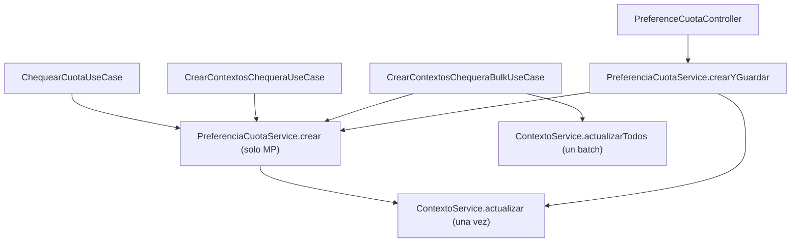

# Persistencia de contextos de Mercado Pago

> Fecha: 2026-10-20
> Estado: decisión de diseño vigente en la migración hexagonal (cambios aún no commiteados).
> Motivo: eliminar las llamadas duplicadas a `updateContext` / `updateContexts`.

## Problema detectado

La creación de una preferencia de cuota persistía el contexto **dos veces**:

1. `CrearPreferenciaCuotaUseCaseImpl.crear(...)` llamaba a `ContextoService.actualizar(...)`.
2. El orquestador (`ChequearCuotaUseCaseImpl`, `CrearContextosChequeraUseCaseImpl`) volvía a llamar a `ContextoService.actualizar(...)` con el mismo contexto.

En el flujo bulk el problema era mayor: `crear(...)` hacía **un PUT individual por cada contexto** y después `CrearContextosChequeraBulkUseCaseImpl` hacía **un PUT batch** con todos, resultando en **N + 1 escrituras** en lugar de una sola.

El patrón venía del código anterior (`PreferenceService.createAndLogPreference` ya llamaba a `updateContext` y `CheckingService`/`ChequeraService` lo repetían).

## Decisión

**El caso de uso de actualización es el único dueño de la persistencia. Los orquestadores deciden *cuándo* invocarlo, una sola vez.**

- Persistencia individual: `ActualizarContextoUseCase` (expuesto por `ContextoService.actualizar`).
- Persistencia batch: `ActualizarContextosUseCase` (expuesto por `ContextoService.actualizarTodos`).
- `CrearPreferenciaCuotaUseCase` quedó **puro**: solo crea/actualiza la preferencia en Mercado Pago y muta el contexto en memoria, sin escribir en el core.
- `PreferenciaCuotaService.crearYGuardar(...)` compone `crear` + persistencia para el endpoint HTTP, persistiendo solo si hubo cambios reales.

## Responsabilidades

| Clase | Responsabilidad |
|---|---|
| `CrearPreferenciaCuotaUseCaseImpl` | Crea/actualiza la preferencia en Mercado Pago. **No persiste.** |
| `ActualizarPreferenciaCuotaUseCaseImpl` | Actualiza la preferencia en Mercado Pago y muta `changed`/`lastVencimientoUpdated`. **No persiste.** |
| `ActualizarContextoUseCaseImpl` / `ActualizarContextosUseCaseImpl` | Único punto de escritura contra `tesoreria-core-service`. |
| `ChequearCuotaUseCaseImpl` | Orquesta: crea la preferencia y persiste una vez. |
| `CrearContextosChequeraUseCaseImpl` | Igual, por cada cuota pendiente. |
| `CrearContextosChequeraBulkUseCaseImpl` | Crea todas las preferencias y persiste con **una sola** llamada batch. |
| `PreferenciaCuotaService.crearYGuardar` | Variante atómica para `POST /preference/create`. Persiste una vez si el contexto cambió. |
| `PreferenceCuotaController` | Usa `crearYGuardar`. |

## Escrituras por flujo

| Flujo | Antes | Ahora |
|---|---|---|
| Unitario, preferencia nueva | 2 PUT | 1 PUT |
| Unitario, `changed == 1` | 1 PUT | 1 PUT |
| Unitario, sin cambios | 1 PUT | 1 PUT |
| Bulk, N preferencias nuevas | N + 1 | 1 batch |
| `POST /preference/create`, preferencia nueva | 1 PUT | 1 PUT |
| `POST /preference/create`, sin cambios | 0 | 0 |

## Diferencias de comportamiento a vigilar

Si aparecen problemas, revisar primero estos tres puntos (son cambios reales respecto del comportamiento anterior, no solo deduplicación):

1. **`POST /preference/create` con `changed == 1` ahora persiste.**
   Antes el controller no escribía en el core en ese camino: el contexto quedaba con `changed = 1` y `lastVencimientoUpdated` viejo, y se reintentaba la actualización en la llamada siguiente. Ahora `crearYGuardar` guarda `changed = 0` y la fecha. Se considera un bug fix.

2. **Los errores del core al persistir ya no abortan el flujo.**
   Antes la escritura interna de `crear(...)` estaba fuera del `try/catch` del orquestador; una excepción del core cortaba `chequear(...)`, el loop de `crearContextosChequera(...)` y el bulk completo. Ahora la única escritura está dentro del `try/catch` existente: se loguea (`Error updating context in Core...`) y el flujo continúa devolviendo las preferencias.

3. **Se eliminó el "retry accidental".**
   Antes, una preferencia nueva hacía dos PUT y el segundo podía compensar un fallo transitorio del primero. Ahora hay un solo intento por contexto. Si se necesita resiliencia, agregar un retry explícito en `ActualizarContextoUseCaseImpl` / `ActualizarContextosUseCaseImpl`, no volver a duplicar la llamada.

## Diagnóstico rápido

- Buscar llamadas a `contextoService.actualizar` / `contextoService.actualizarTodos` en `procesos/`:
  - `ChequearCuotaUseCaseImpl`
  - `CrearContextosChequeraUseCaseImpl`
  - `CrearContextosChequeraBulkUseCaseImpl`
  - `PreferenciaCuotaService.crearYGuardar`
  - `CrearPreferenciaVacanteUseCaseImpl` (flujo de vacantes, persiste dentro de su propio caso de uso)
- Si aparece una escritura extra, verificar que no se haya vuelto a agregar persistencia dentro de `CrearPreferenciaCuotaUseCaseImpl` o `ActualizarPreferenciaCuotaUseCaseImpl`.

## Tests

- `PreferenciaCuotaServiceTest`: `crear` no persiste; `crearYGuardar` persiste una sola vez y solo cuando corresponde.
- `PreferenciaCuotaUseCasesTest`: el caso de uso de creación ya no persiste.
- `ChequearCuotaUseCaseImplTest` y `ChequeraUseCasesTest`: los orquestadores persisten una vez (individual o batch).
- `HttpContractTest`: el controller usa `crearYGuardar`.

Los tests actuales **no** cubren la semántica de error del punto 2 (aborto vs. log-and-continue). Si se decide restaurar el comportamiento estricto, agregar un test que verifique la propagación.
